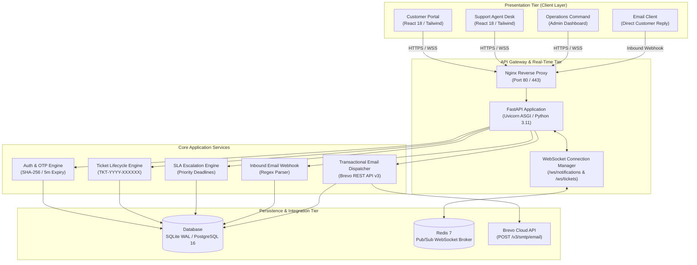
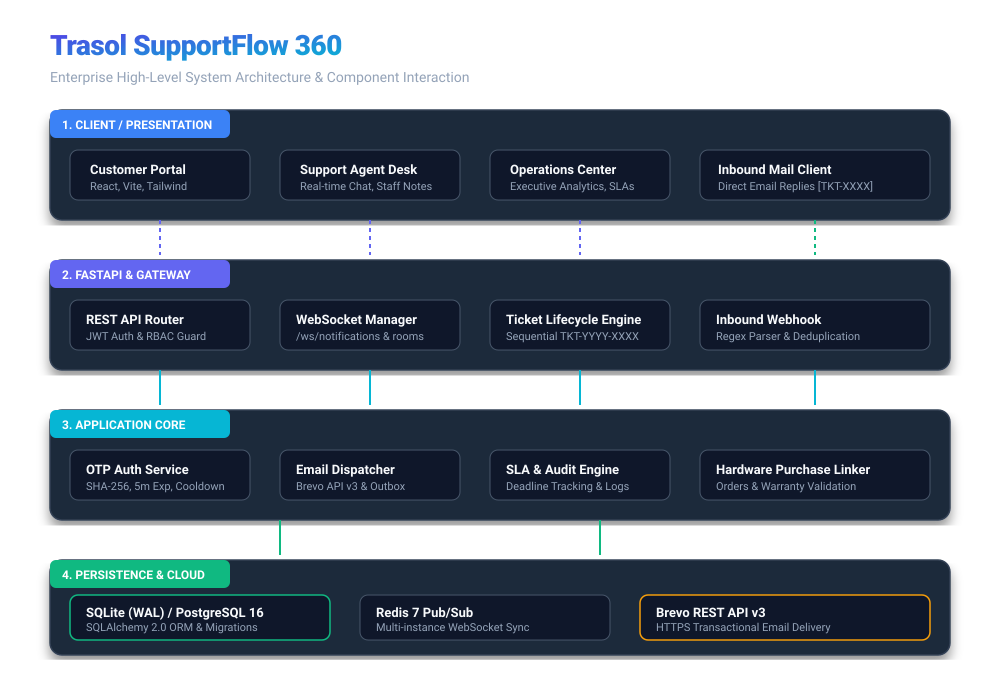
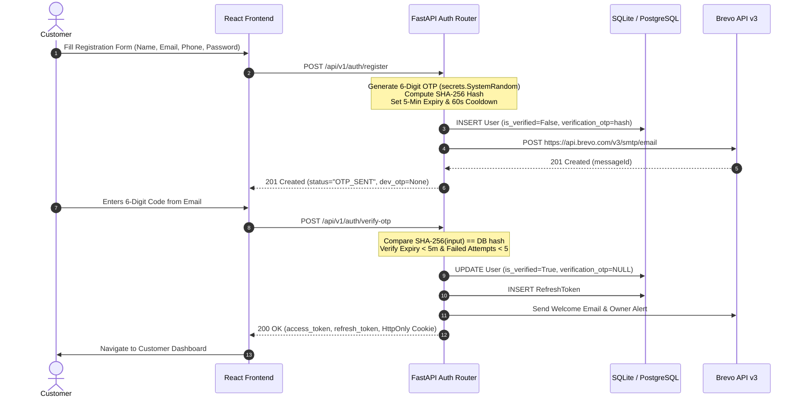
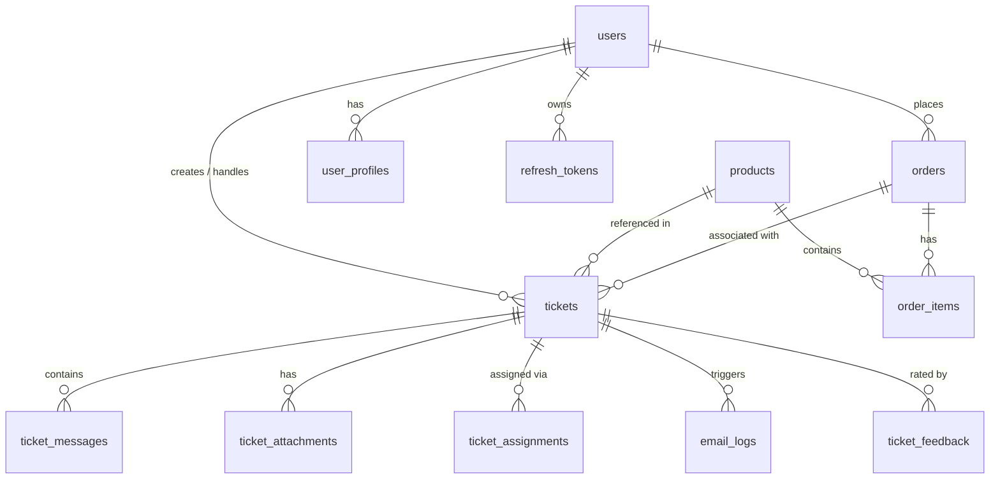
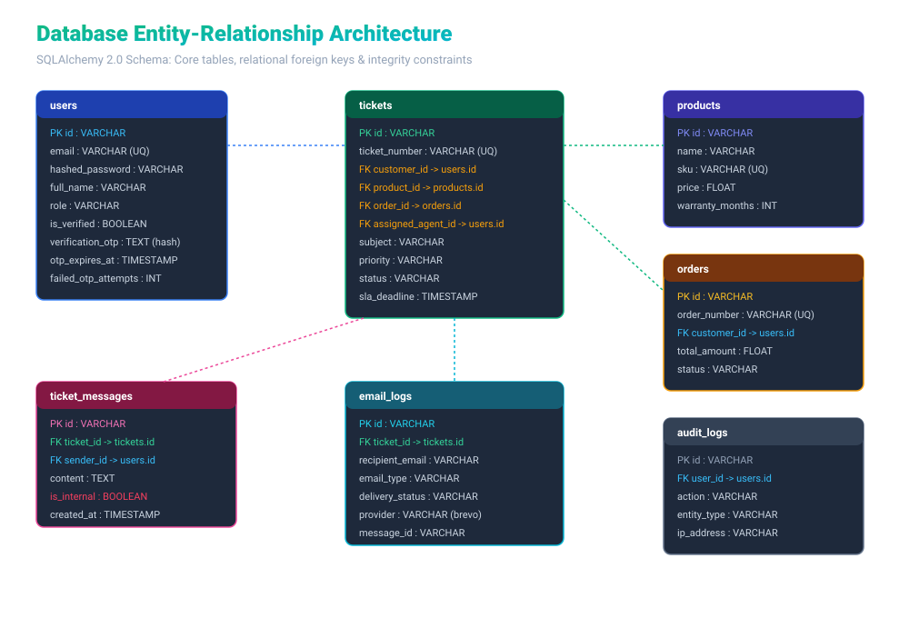

# System Architecture & Technical Design

## Trasol SupportFlow 360 (SupportDesk 360)

---

## 1. Architectural Overview & Design Principles

**Trasol SupportFlow 360** is an enterprise-grade customer support, complaint management, and real-time ticket resolution platform. Designed specifically for high-reliability IoT edge gateways, hardware devices, and industrial warranty support, the platform enforces strict data isolation, guaranteed sequential ticket numbering, cryptographic authentication, and bidirectional real-time synchronization.





### Core Architectural Principles
1. **Zero-Trust Role-Based Access Control (RBAC)**: All endpoints strictly validate JWT bearer tokens and enforce role hierarchy (`customer`, `agent`, `admin`, `super_admin`).
2. **Staff Note Privacy Invariant**: Internal staff notes (`is_internal = True`) are filtered at the SQL query level and are structurally omitted from customer API responses.
3. **Optimistic Real-Time Sync with Graceful Degradation**: Real-time events push through WebSockets, backed by transactional database state so clients recover state seamlessly on reconnection.
4. **Idempotent Inbound Processing**: Inbound email replies are deduplicated using external email message IDs and matched via deterministic regex patterns.
5. **Fail-Safe Transactional Outbox**: Email notifications write an event record to the database transactional outbox (`outbox_events` and `email_logs`) before dispatch.

---

## 2. Multi-Tier Layer Decomposition

### 2.1 Presentation Tier (Frontend)
* **Framework**: React 18 with TypeScript.
* **Build Tool**: Vite 5.
* **Styling**: Tailwind CSS with utility-first dark/light themed design.
* **State Management**:
  * `AuthContext`: Centralized JWT authentication state, token refresh, auto-session renewal, and user profile management.
  * `SocketContext`: Global WebSocket lifecycle manager handling automatic reconnects, ping/pong heartbeats, and real-time event dispatching.
* **Data Fetching**: TanStack React Query v5 for client-side caching, background refetching, and mutation states.
* **Forms & Validation**: React Hook Form with Zod schemas for client-side input validation.
* **Routing**: React Router v6 with `ProtectedRoute` role guards enforcing role segregation.

### 2.2 API & Gateway Tier (Backend)
* **Runtime**: Python 3.11 with FastAPI running on Uvicorn ASGI.
* **Validation & Schemas**: Pydantic v2 for request/response serialization and validation.
* **Middleware**:
  * CORS Middleware supporting controlled origins with wildcard support for local development.
  * Static file mount for file attachments (`/uploads`).
* **Session Management**: Dual support for HTTP-only cookies (`access_token`) and `Authorization: Bearer <token>` headers.

### 2.3 Real-Time WebSocket Infrastructure
The real-time layer is managed by `ConnectionManager` ([backend/app/websockets/manager.py](../backend/app/websockets/manager.py)):
* **`/ws/notifications?token={jwt}`**: User-specific notification stream. Used for system alerts, assignment changes, and admin customer registration notifications.
* **`/ws/tickets/{ticket_id}?token={jwt}`**: Ticket chat room channel. Broadcasts new customer replies and public agent messages to all active viewers of the ticket.
* **Security**: The WebSocket handshake decodes the JWT token via `get_ws_user()`. If invalid or expired, the connection is terminated with code `1008 (Policy Violation)`.
* **Scalability**: Multi-worker deployments leverage Redis Pub/Sub to synchronize broadcast events across independent FastAPI instances.

### 2.4 Application Services Tier



#### Authentication & OTP Engine
* **Password Hashing**: Bcrypt with salted password rounds.
* **OTP Generation**: Cryptographically secure 6-digit integers generated via `secrets.SystemRandom().randint(100000, 999999)`.
* **Storage**: Stored strictly as a SHA-256 hash in `users.verification_otp`. Plaintext OTPs are never stored and never returned in API payloads.
* **Security Controls**:
  * 5-minute strict expiration (`otp_expires_at`).
  * 60-second resend cooldown (`HTTP 429 Too Many Requests`).
  * 5-attempt incorrect limit lockout.

#### Ticket Lifecycle & Sequential Numbering
* Sequential ticket numbering (`TKT-YYYY-000001`) prevents race conditions and collision under concurrent ticket submissions.
* SLA tracking assigns priority-based resolution deadlines (Critical: 4h, High: 12h, Medium: 24h, Low: 48h).
* Automatic SLA breach detection checks `sla_deadline < now()` for unresolved tickets.

#### Email Delivery & Outbox Engine
* **Primary Provider**: Brevo REST API v3 (`POST https://api.brevo.com/v3/smtp/email`) using HTTP headers `api-key`, `Content-Type: application/json`, and `Accept: application/json`.
* **Simulation Mode**: For evaluation or offline development when `BREVO_API_KEY` is not supplied, the system persists all email events to the database `email_logs` table with status `SIMULATED_DEV`.
* **Inbound Reply Ingestion**: Accepts webhook JSON payloads at `/api/v1/inbound/webhook`, parses ticket IDs via regex `r"\[(TKT-\d{4}-\d{6})\]"`, deduplicates via `message_id`, and appends messages directly to the active ticket thread.

---

## 3. Persistence Architecture





### Concurrency & Locking Strategy
* **SQLite Configuration**:
  * Connected with `check_same_thread=False` and `timeout=30.0` seconds.
  * Automatic connection hooks enforce:
    ```sql
    PRAGMA journal_mode = WAL;
    PRAGMA synchronous = NORMAL;
    PRAGMA busy_timeout = 30000;
    ```
  * Write-Ahead Logging (`WAL`) allows unlimited concurrent readers alongside active writers, preventing database lock errors under load.
* **PostgreSQL Production Configuration**:
  * Production deployments point `DATABASE_URL` to PostgreSQL 16 Alpine.
  * Managed connection pooling via SQLAlchemy `QueuePool` with health pre-pings (`pool_pre_ping=True`).
