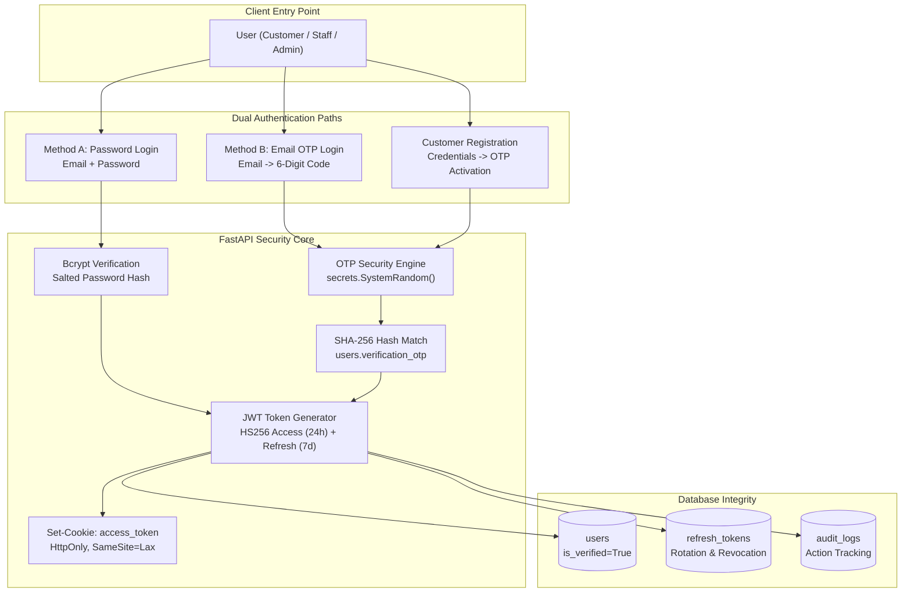
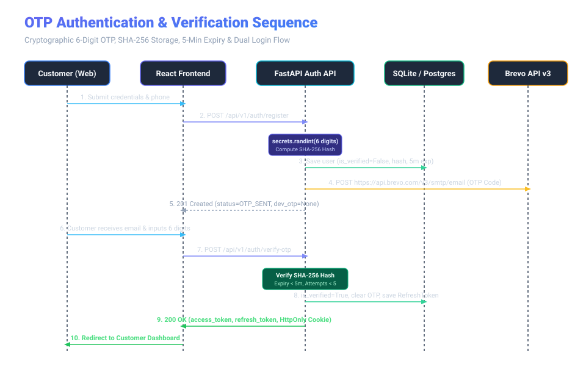

# Authentication, Authorization & Security Architecture

## Trasol SupportFlow 360 (SupportDesk 360)

---

## 1. Security Architecture Overview

**Trasol SupportFlow 360** implements enterprise-grade identity, authentication, and authorization mechanisms. The application combines **Bcrypt password hashing**, **cryptographic One-Time Passwords (OTP)**, **JWT access tokens with refresh token rotation**, **HTTP-only secure cookies**, and a strict **Role-Based Access Control (RBAC)** hierarchy.





---

## 2. Cryptographic OTP Verification Workflow

### 2.1 OTP Generation
* **Entropy Source**: `secrets.SystemRandom().randint(100000, 999999)` using the operating system's CSPRNG (Cryptographically Secure Pseudo-Random Number Generator).
* **Format**: Strictly 6 numeric decimal digits (`^\d{6}$`).

### 2.2 Secure Storage Strategy
* Plaintext OTP codes are **never** stored in the database.
* The backend computes a SHA-256 hash using `hashlib.sha256(otp.encode('utf-8')).hexdigest()`.
* The computed hash is stored in `users.verification_otp`.
* **Zero Client Leakage**: The OTP code is delivered solely via the Brevo Transactional Email API. The API response strictly returns `dev_otp: null`, preventing browser or network sniffing of verification codes.

### 2.3 Expiration, Cooldown & Lockout Rules

| Security Constraint | Parameter | Behavior on Violation |
|---|---|---|
| **Validity Window** | **5 minutes** (`otp_expires_at`) | Returns `HTTP 400 Bad Request` ("Verification code has expired"). Invalidation clears the hash from the database. |
| **Resend Cooldown** | **60 seconds** (`otp_last_sent_at`) | Returns `HTTP 429 Too Many Requests` ("Please wait X seconds before requesting a new code"). Prevents email bombing. |
| **Failed Attempt Lockout** | **5 attempts maximum** (`failed_otp_attempts`) | Each incorrect entry decrements remaining attempts (`HTTP 400`). On the 5th failed attempt, the code is immediately invalidated (`HTTP 429`). |
| **Post-Verification Clearing** | Single-use | Upon successful verification, `verification_otp`, `otp_expires_at`, and `failed_otp_attempts` are reset to `NULL` / `0`. |

---

## 3. Dual Authentication Methods

The platform provides two primary authentication mechanisms on `/login`:

### Method A: Email + Password Authentication
1. Customer or Administrator submits their email and password.
2. The system locates the user and validates the password hash via `verify_password()`.
3. Verifies that the account is active (`is_active == True`).
4. Verifies that the account is email-verified (`is_verified == True`). If unverified, returns `HTTP 403 Forbidden` directing the customer to complete OTP activation.
5. Issues JWT access token, creates `RefreshToken` record, writes `AuditLog`, and sets an HTTP-only cookie.

### Method B: Email OTP Passwordless Authentication
1. Customer enters their registered email and clicks **Request Login Code**.
2. Endpoint `/api/v1/auth/request-login-otp` validates that the user exists and is active.
3. Generates a fresh 6-digit cryptographic OTP, hashes it, applies the 5-minute expiry and 60-second cooldown, and dispatches an email via Brevo API v3.
4. Customer inputs the 6-digit code.
5. Endpoint `/api/v1/auth/verify-otp` validates the hash, resets attempt counters, marks `is_verified = True`, and issues identical JWT credentials and HTTP-only cookies as password login.

---

## 4. JWT & Session Security

### 4.1 Token Structure
* **Algorithm**: `HS256` (HMAC with SHA-256).
* **Access Token Lifespan**: 1,440 minutes (24 hours).
* **Refresh Token Lifespan**: 7 days.
* **Payload Claims**:
  ```json
  {
    "sub": "11c7b8eb-42d4-4904-8899-c72c25d6e5ce",
    "role": "admin",
    "type": "access",
    "iat": 1732450000,
    "exp": 1732536400
  }
  ```

### 4.2 Refresh Token Rotation
* Stored in the `refresh_tokens` database table.
* When `/api/v1/auth/refresh` is called, the old refresh token is marked `is_revoked = True` and a fresh access/refresh pair is issued.

### 4.3 HTTP-Only Cookie
To mitigate Cross-Site Scripting (XSS) attacks, the API returns the access token as an HTTP-only cookie in addition to the JSON payload:
```http
Set-Cookie: access_token=eyJhbGciOi...; HttpOnly; Max-Age=86400; Path=/; SameSite=Lax
```

---

## 5. Role-Based Access Control (RBAC) Matrix

Access permissions are enforced across all backend endpoints through FastAPI dependency injection (`get_current_user`, `require_admin`, `require_super_admin`):

| Resource / Action | Customer | Support Agent | Operations Admin | Super Admin |
|---|:---:|:---:|:---:|:---:|
| **Register & Login (Password / OTP)** | ✅ | ✅ | ✅ | ✅ |
| **View Own Purchased Hardware & Orders**| ✅ | ❌ | ✅ | ✅ |
| **Raise Support Ticket for Owned Product**| ✅ | ❌ | ❌ | ❌ |
| **Post Public Message on Ticket** | ✅ (own) | ✅ (assigned) | ✅ (all) | ✅ (all) |
| **Post Private Internal Staff Note** | ❌ (blocked)| ✅ | ✅ | ✅ |
| **Reassign Ticket to Agent** | ❌ | ❌ | ✅ | ✅ |
| **Resolve Ticket & Log Timestamps** | ❌ | ✅ | ✅ | ✅ |
| **Submit Post-Resolution Rating** | ✅ (own) | ❌ | ❌ | ❌ |
| **Operations Command Center Analytics**| ❌ | ❌ | ✅ | ✅ |
| **Export Tickets to CSV** | ❌ | ❌ | ✅ | ✅ |
| **Inspect Email Logs & Outbox Delivery**| ❌ | ❌ | ✅ | ✅ |
| **View Compliance Audit Trail** | ❌ | ❌ | ✅ | ✅ |
| **Configure SLA Policies & Company Settings**| ❌ | ❌ | ❌ | ✅ |

---

## 6. Staff Note Privacy Invariant

A critical security requirement is the complete isolation of **Internal Staff Notes** from customers.

### Backend Implementation
When a customer requests ticket details via `GET /api/v1/tickets/{id}`, the backend enforces:
```python
# In backend/app/api/endpoints/tickets.py
if current_user.role == "customer":
    messages = [m for m in ticket.messages if not m.is_internal]
```
* Internal notes (`is_internal = True`) are excluded at the data mapping layer before JSON serialization.
* Automated integration test `test_agent_conversation_and_internal_notes` in `tests/test_full_suite.py` asserts `assert len(internal_notes_in_cust_view) == 0` with zero exceptions.

---

## 7. WebSocket Security & Handshake

WebSockets at `/ws/notifications` and `/ws/tickets/{ticket_id}` require authentication via a query parameter `?token=<access_token>`:
1. `get_ws_user(token, db)` decodes the token and validates the user exists and `is_active == True`.
2. If the token is missing, expired, or invalid, the connection is closed immediately with code `1008 (Policy Violation)`.
3. In ticket chat rooms, customer connections are verified against `ticket.customer_id == user.id`. Customers cannot subscribe to tickets they do not own.

---

## 8. Audit Logging & Non-Repudiation

Authentication and critical authorization actions write persistent records to the `audit_logs` table:
* `USER_LOGIN`: IP address, user email, timestamp.
* `USER_REGISTERED_PENDING_OTP`: Registration event, OTP generation.
* `USER_OTP_VERIFIED`: Successful verification, account activation.
* `TICKET_ASSIGNED`: Reassignment history with assigner and assignee IDs.
