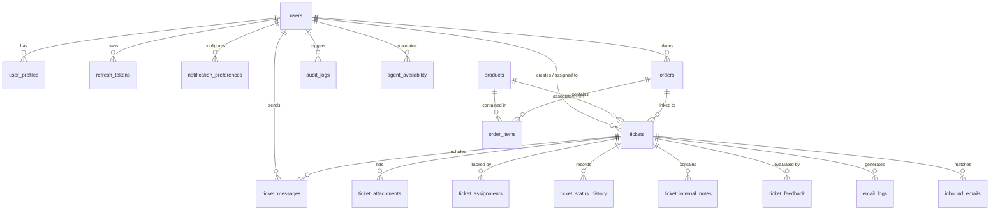
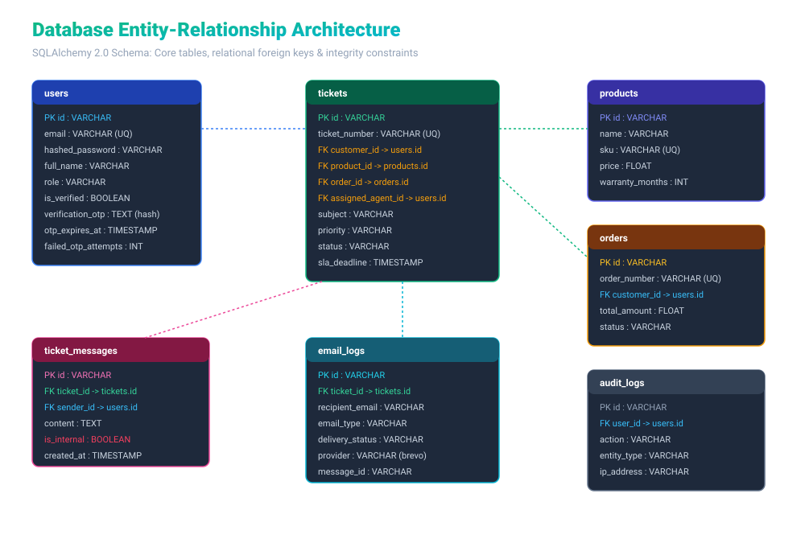

# Database Design & Schema Architecture

## Trasol SupportFlow 360 (SupportDesk 360)

---

## 1. Overview & ORM Framework

The **Trasol SupportFlow 360** persistence tier is built on **SQLAlchemy 2.0** declarative models with strict relationship mapping, foreign key constraints, and multi-database compatibility.

* **Development Database**: SQLite 3 with Write-Ahead Logging (`WAL`), 30-second busy timeout, and connection event hooks.
* **Production Database**: PostgreSQL 16 Alpine with managed connection pooling (`QueuePool`).
* **Migrations**: Alembic migration scripts.
* **Primary Key Convention**: UUID v4 strings (`generate_uuid`) for distributed safety and prevention of sequential ID harvesting.

---

## 2. Entity-Relationship Diagram





---

## 3. Detailed Table Specifications

### 3.1 Identity & Access Tables

#### `users`
Core user identity representing Customers, Support Agents, Administrators, and Super Administrators.
| Column | Type | Constraints | Description |
|---|---|---|---|
| `id` | VARCHAR | PRIMARY KEY | UUID v4 string |
| `email` | VARCHAR | UNIQUE, NOT NULL, INDEX | Primary email address |
| `hashed_password` | VARCHAR | NOT NULL | Bcrypt salted hash |
| `full_name` | VARCHAR | NOT NULL | Full name of user |
| `phone` | VARCHAR | NULLABLE | Phone number for SMS notifications |
| `role` | VARCHAR | NOT NULL, DEFAULT 'customer' | `customer`, `agent`, `admin`, `super_admin` |
| `is_active` | BOOLEAN | DEFAULT TRUE | Account operational status |
| `is_verified` | BOOLEAN | DEFAULT FALSE | Email verification status |
| `avatar_url` | VARCHAR | NULLABLE | Profile picture URL |
| `verification_otp` | TEXT | NULLABLE | SHA-256 hash of active 6-digit OTP |
| `otp_expires_at` | TIMESTAMP | NULLABLE | 5-minute validity window |
| `otp_last_sent_at` | TIMESTAMP | NULLABLE | Timestamp of last OTP dispatch (60s cooldown) |
| `failed_otp_attempts`| INTEGER | DEFAULT 0 | Counter for failed verification attempts (max 5) |
| `created_at` | DATETIME | DEFAULT utcnow | Account creation timestamp |
| `updated_at` | DATETIME | DEFAULT utcnow | Last modification timestamp |

#### `user_profiles`
Extended profile information for customers and technicians.
| Column | Type | Constraints | Description |
|---|---|---|---|
| `id` | VARCHAR | PRIMARY KEY | UUID v4 string |
| `user_id` | VARCHAR | FK(`users.id`), UNIQUE | Associated user ID |
| `company_name` | VARCHAR | NULLABLE | Organization / Company name |
| `job_title` | VARCHAR | NULLABLE | Professional role / title |
| `department` | VARCHAR | NULLABLE | Department name |
| `timezone` | VARCHAR | DEFAULT 'UTC' | User local timezone |
| `address` | VARCHAR | NULLABLE | Shipping / billing address |
| `phone_verified` | BOOLEAN | DEFAULT FALSE | SMS phone verification status |
| `two_factor_enabled`| BOOLEAN | DEFAULT FALSE | 2FA toggle |

#### `refresh_tokens`
Persistent storage for refresh token rotation.
| Column | Type | Constraints | Description |
|---|---|---|---|
| `id` | VARCHAR | PRIMARY KEY | UUID v4 string |
| `user_id` | VARCHAR | FK(`users.id`), NOT NULL | Associated user ID |
| `token` | VARCHAR | UNIQUE, NOT NULL, INDEX | Refresh token string |
| `expires_at` | DATETIME | NOT NULL | Expiration timestamp (7 days) |
| `is_revoked` | BOOLEAN | DEFAULT FALSE | Revocation status |
| `created_at` | DATETIME | DEFAULT utcnow | Issuance timestamp |

---

### 3.2 Hardware, Products & Orders

#### `products`
Hardware equipment, edge gateways, and industrial devices supported by Trasol.
| Column | Type | Constraints | Description |
|---|---|---|---|
| `id` | VARCHAR | PRIMARY KEY | UUID v4 string |
| `name` | VARCHAR | NOT NULL | Product name (e.g. Edge Gateway Pro 4G) |
| `sku` | VARCHAR | UNIQUE, NOT NULL, INDEX | Stock Keeping Unit |
| `description` | VARCHAR | NULLABLE | Product technical brief |
| `category` | VARCHAR | NOT NULL | Hardware classification |
| `price` | FLOAT | DEFAULT 0.0 | Unit price |
| `warranty_months` | INTEGER | DEFAULT 12 | Standard warranty duration |
| `is_active` | BOOLEAN | DEFAULT TRUE | Active catalogue toggle |
| `created_at` | DATETIME | DEFAULT utcnow | Creation timestamp |

#### `orders`
Customer hardware purchases and warranty contracts.
| Column | Type | Constraints | Description |
|---|---|---|---|
| `id` | VARCHAR | PRIMARY KEY | UUID v4 string |
| `order_number` | VARCHAR | UNIQUE, NOT NULL, INDEX | Sequential order number (`ORD-YYYY-XXXX`) |
| `customer_id` | VARCHAR | FK(`users.id`), NOT NULL | Purchasing customer |
| `total_amount` | FLOAT | NOT NULL | Order invoice total |
| `currency` | VARCHAR | DEFAULT 'USD' | Currency code |
| `status` | VARCHAR | DEFAULT 'Completed' | Order status |
| `shipping_address` | VARCHAR | NULLABLE | Delivery location |
| `created_at` | DATETIME | DEFAULT utcnow | Order timestamp |

#### `order_items`
Individual serialized hardware units linked to customer orders.
| Column | Type | Constraints | Description |
|---|---|---|---|
| `id` | VARCHAR | PRIMARY KEY | UUID v4 string |
| `order_id` | VARCHAR | FK(`orders.id`), NOT NULL | Associated order |
| `product_id` | VARCHAR | FK(`products.id`), NOT NULL | Hardware product |
| `quantity` | INTEGER | DEFAULT 1 | Item quantity |
| `unit_price` | FLOAT | NOT NULL | Item price |
| `serial_number` | VARCHAR | NULLABLE | Unique hardware serial / IMEI |

---

### 3.3 Ticket Lifecycle & Customer Support

#### `tickets`
Central incident complaint and support ticket record.
| Column | Type | Constraints | Description |
|---|---|---|---|
| `id` | VARCHAR | PRIMARY KEY | UUID v4 string |
| `ticket_number` | VARCHAR | UNIQUE, NOT NULL, INDEX | Sequential code (`TKT-YYYY-000001`) |
| `customer_id` | VARCHAR | FK(`users.id`), NOT NULL | Submitting customer |
| `product_id` | VARCHAR | FK(`products.id`), NULLABLE | Purchased hardware item |
| `order_id` | VARCHAR | FK(`orders.id`), NULLABLE | Associated hardware order |
| `assigned_agent_id`| VARCHAR | FK(`users.id`), NULLABLE | Assigned support technician |
| `subject` | VARCHAR | NOT NULL | Issue title / summary |
| `description` | TEXT | NOT NULL | Problem narrative |
| `category` | VARCHAR | NOT NULL | Technical category |
| `priority` | VARCHAR | NOT NULL | `Critical`, `High`, `Medium`, `Low` |
| `status` | VARCHAR | NOT NULL, DEFAULT 'Open' | `Open`, `Assigned`, `In Progress`, `Waiting for Customer`, `Resolved`, `Closed` |
| `sla_deadline` | TIMESTAMP | NULLABLE | Target resolution deadline |
| `resolved_at` | TIMESTAMP | NULLABLE | Timestamp of resolution |
| `closed_at` | TIMESTAMP | NULLABLE | Timestamp of ticket closure |
| `preferred_contact_method` | VARCHAR | DEFAULT 'email' | `email`, `phone`, `portal` |
| `created_at` | DATETIME | DEFAULT utcnow | Creation timestamp |
| `updated_at` | DATETIME | DEFAULT utcnow | Last modification timestamp |

#### `ticket_messages`
Conversation dialogue between customer and support technicians.
| Column | Type | Constraints | Description |
|---|---|---|---|
| `id` | VARCHAR | PRIMARY KEY | UUID v4 string |
| `ticket_id` | VARCHAR | FK(`tickets.id`), NOT NULL | Associated ticket |
| `sender_id` | VARCHAR | FK(`users.id`), NOT NULL | Message author |
| `message_type` | VARCHAR | DEFAULT 'customer_reply' | Message category |
| `content` | TEXT | NOT NULL | Message body |
| `is_internal` | BOOLEAN | DEFAULT FALSE | If TRUE, visible strictly to staff |
| `created_at` | DATETIME | DEFAULT utcnow | Message timestamp |

#### `ticket_feedback`
Post-resolution customer ratings and satisfaction surveys.
| Column | Type | Constraints | Description |
|---|---|---|---|
| `id` | VARCHAR | PRIMARY KEY | UUID v4 string |
| `ticket_id` | VARCHAR | FK(`tickets.id`), UNIQUE, NOT NULL | Target ticket |
| `customer_id` | VARCHAR | FK(`users.id`), NOT NULL | Customer submitting rating |
| `rating` | INTEGER | NOT NULL | 1 to 5 stars |
| `comments` | TEXT | NULLABLE | Customer remarks |
| `created_at` | DATETIME | DEFAULT utcnow | Survey timestamp |

---

### 3.4 Email, SLA & Audit Tables

#### `email_logs`
Transactional email audit trail recording all outbound dispatches.
| Column | Type | Constraints | Description |
|---|---|---|---|
| `id` | VARCHAR | PRIMARY KEY | UUID v4 string |
| `ticket_id` | VARCHAR | FK(`tickets.id`), NULLABLE | Linked ticket |
| `recipient_email` | VARCHAR | NOT NULL | Recipient address |
| `recipient_type` | VARCHAR | NOT NULL | `customer`, `owner`, `agent`, `admin` |
| `email_type` | VARCHAR | NOT NULL | Template code |
| `subject` | VARCHAR | NOT NULL | Email subject |
| `content_preview` | TEXT | NULLABLE | Snippet of dispatched HTML |
| `delivery_status` | VARCHAR | DEFAULT 'SENT' | `SENT`, `SIMULATED_DEV`, `FAILED` |
| `provider` | VARCHAR | DEFAULT 'brevo' | `brevo`, `smtp`, `simulation` |
| `message_id` | VARCHAR | NULLABLE | Brevo or SMTP message identifier |
| `error_message` | TEXT | NULLABLE | Error description if rejected |
| `retry_count` | INTEGER | DEFAULT 0 | Delivery retry counter |
| `created_at` | DATETIME | DEFAULT utcnow | Dispatch timestamp |

#### `audit_logs`
Immutable compliance log recording security-critical events.
| Column | Type | Constraints | Description |
|---|---|---|---|
| `id` | VARCHAR | PRIMARY KEY | UUID v4 string |
| `user_id` | VARCHAR | FK(`users.id`), NULLABLE | Acting user |
| `user_email` | VARCHAR | NULLABLE | User email snapshot |
| `action` | VARCHAR | NOT NULL | `USER_LOGIN`, `USER_REGISTERED_PENDING_OTP`, `USER_OTP_VERIFIED` |
| `entity_type` | VARCHAR | NOT NULL | `user`, `ticket`, `order` |
| `entity_id` | VARCHAR | NULLABLE | Target record ID |
| `details` | TEXT | NULLABLE | Structured context |
| `ip_address` | VARCHAR | NULLABLE | Client remote IP address |
| `created_at` | DATETIME | DEFAULT utcnow | Event timestamp |

---

## 4. SQLite WAL Mode & Concurrency Configuration

To prevent concurrency deadlocks (`sqlite3.OperationalError: database is locked`) when running on SQLite, [backend/app/core/database.py](../backend/app/core/database.py) configures SQLite with:
```python
connect_args = {
    "check_same_thread": False,
    "timeout": 30.0
}

engine = create_engine(settings.DATABASE_URL, connect_args=connect_args, pool_pre_ping=True)

@event.listens_for(engine, "connect")
def set_sqlite_pragma(dbapi_connection, connection_record):
    if settings.DATABASE_URL.startswith("sqlite"):
        cursor = dbapi_connection.cursor()
        cursor.execute("PRAGMA journal_mode=WAL")
        cursor.execute("PRAGMA synchronous=NORMAL")
        cursor.execute("PRAGMA busy_timeout=30000")
        cursor.close()
```
* **WAL Mode**: Writes append to a write-ahead log (`trasol_supportdesk.db-wal`) while readers access the main database without waiting for write transactions to finish.
* **Busy Timeout (30s)**: If two concurrent writes collide, SQLite retries for up to 30,000 milliseconds rather than immediately throwing an exception.
